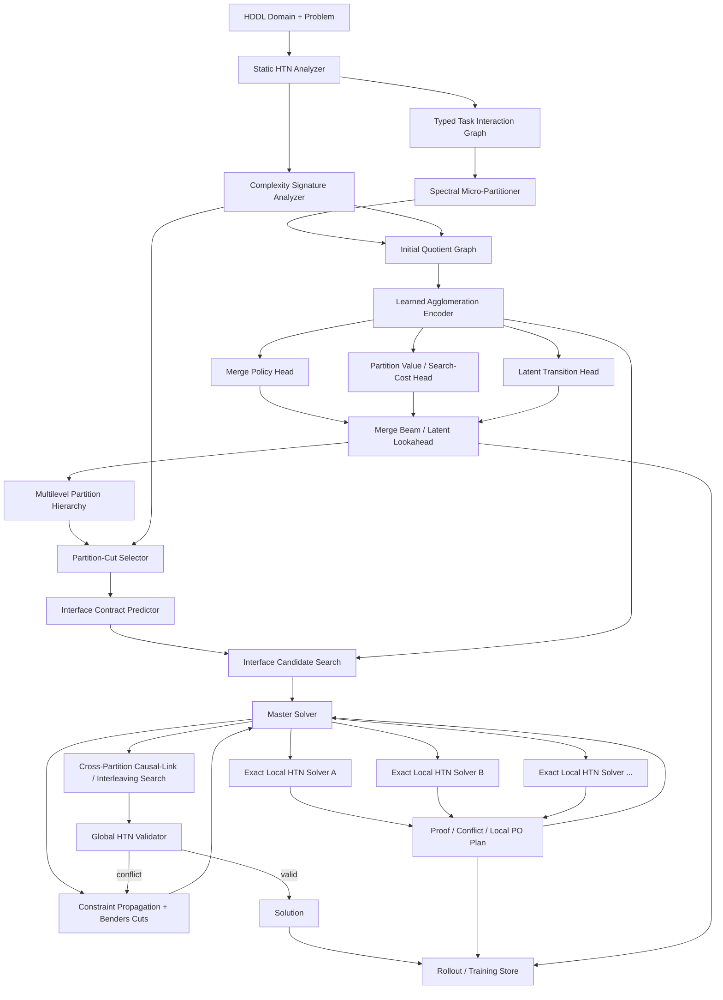
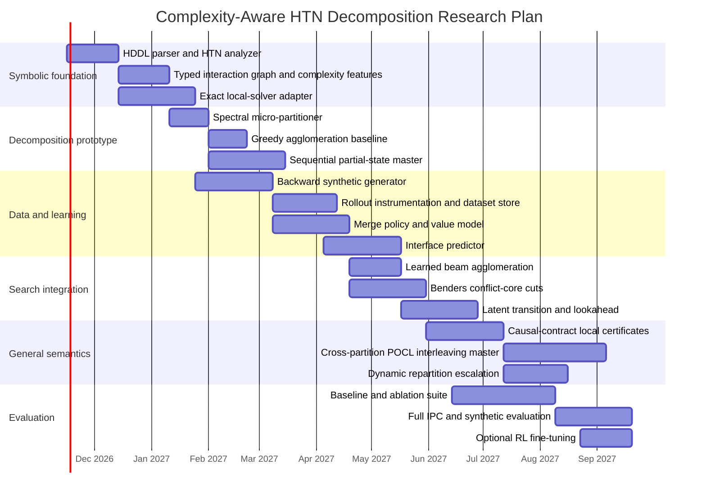

# Complexity-Aware Learnable HTN Decomposition with Contract-Based Master Search

## Executive summary

The most defensible architecture is **not** a learned end-to-end HTN planner. It is a symbolic decomposition-and-search system in which learning proposes partitions, interface contracts, and search priorities, while exact planners and a master constraint solver retain responsibility for correctness. That division is important because unrestricted partially ordered HTN planning with arbitrary recursion is only semi-decidable; no implementation can be complete over the unrestricted formalism. Alford, Bercher, and Aha’s classification therefore should be treated as an architectural constraint: the system can be complete on explicitly identified decidable fragments, or under an explicit decomposition-depth bound, while remaining sound and anytime on more general inputs. Their results also show why “more ordering” is not monotonically easier: for ground problems, acyclic totally ordered HTN planning is PSPACE-complete, acyclic partially ordered planning is NEXPTIME-complete, arbitrary-recursive totally ordered planning is EXPTIME-complete, and arbitrary-recursive partially ordered planning crosses into semi-decidability. citeturn641749view0turn186694view0 The 2026 result by Lauer, Zhang, Haslum, and Bercher adds an especially important target fragment: fully unordered HTN planning is PSPACE-complete, matching STRIPS plan-existence complexity while retaining greater expressive power. citeturn285786search0turn285786search2

That motivates a planner whose structural objective is **not simply to minimize graph cuts**. It should maximize the amount of the problem that lands in favorable structural fragments—especially fully unordered components—while minimizing cross-partition causal coupling, interface entropy, difficult ordered residues, and local-search cost. The Alford/Bercher/Aha typology becomes both a feature set and a soft structural prior; the new unordered-HTN result gives a specific reward for producing fully unordered subproblems. Complexity labels are worst-case properties of classes rather than instance-runtime predictions, so they should bias partitioning rather than replace learned runtime estimates. citeturn641749view0turn285786search2

The proposed pipeline begins with deliberately small **spectral micro-partitions**. Spectral methods are appropriate here because they supply a stable, nonlearned graph decomposition from global connectivity structure; normalized-cut and related spectral methods derive partitions from eigenvectors of graph Laplacians rather than asking a network to solve a discrete clustering problem directly. citeturn376268search0turn376268search1 A learned agglomeration policy then operates on the quotient graph, selecting pairwise merges and a stopping level. This turns a difficult learned clustering problem into sequential ranking over a constrained candidate set.

Interfaces should evolve in capability. The first implementation should permit only **sequentially composable partitions** and represent their interfaces as partial boundary states. The production architecture should instead use **causal contracts** and allow the master solver to interleave local partial-order plans. PANDA’s history is directly relevant: its plan-space solver combines HTN refinement with Partial-Order Causal-Link reasoning, and partial-order plans compactly represent multiple linearizations while causal links encode support relationships. citeturn497953search0turn497953search5 The long-term master solver should therefore reason about open conditions, producers, threats, cross-partition ordering decisions, preservation requirements, and resources rather than forcing subplans to form contiguous blocks.

The SGPlan analogy is useful but should not be copied mechanically. SGPlan partitions planning constraints around subgoals, solves smaller subproblems, and repairs violated global constraints; its empirical success established that partition-and-resolve can outperform monolithic treatment when constraint locality is strong. citeturn183319search0turn183319search1 The proposed HTN system generalizes this idea: the master selects interfaces and cross-partition commitments, exact HTN subsolvers validate them, and failed assumptions produce **logic-based Benders-style cuts**. Logic-based Benders decomposition was explicitly designed to let arbitrary combinatorial subproblems produce logical deductions that refine a master problem, and has been applied to planning/scheduling combinations of MIP and constraint programming. citeturn233833search0turn233833search2

Learning belongs primarily in three places: a merge policy, an interface-contract proposal model, and policy/value/latent-transition heads used for bounded latent lookahead. Policy-Guided Heuristic Search demonstrates that policy and heuristic estimates can jointly guide deterministic search while retaining search-level guarantees, and recent HTN work has now demonstrated learned heuristic functions over hierarchical planning representations. citeturn694799search3turn876853search0 LatPlan and ELAST provide two complementary precedents for latent planning: LatPlan learns symbolic latent models and delegates exact planning to a classical planner, whereas ELAST explicitly performs tree search in a learned latent state/transition space. citeturn694799search0turn694799search2 For this project, the safer synthesis is shallow latent lookahead over **merge and interface decisions**, with frequent re-encoding from exact symbolic states, rather than long open-loop latent simulation.

The concrete initial prototype I recommend is therefore: **normalized-Laplacian micro-partitions; greedy/beam learned agglomeration; partial-state sequential interfaces; exact progression-based local HTN solving; a CP/SMT-style master with verified no-good cuts; a small graph encoder with merge-policy and log-search-cost value heads; supervised training from backward-generated solutions and planner rollouts; no RL initially.** Interleaving contracts and latent transition lookahead should be designed into the data model from the start but enabled only after the sequential implementation is stable.

## Research foundations and design constraints

The architecture should make a deliberate distinction between **formal complexity**, **empirical instance difficulty**, and **decomposition utility**. Alford, Bercher, and Aha vary three syntactic dimensions—recursion, task ordering, and variables—and find large jumps in plan-existence complexity across their combinations. For ground HTNs, their published completeness table includes PSPACE for acyclic/total, NEXPTIME for acyclic/partial, PSPACE for tail-recursive/total, EXPSPACE for tail-recursive/partial, EXPTIME for arbitrary-recursive/total, and semi-decidability for arbitrary-recursive/partial problems. Lifted variables can increase these bounds further; constant-free methods mitigate some of those increases. citeturn641749view0

The classification should therefore be encoded as a **complexity signature**

\[
\kappa(P)=
(\rho,\omega,\nu,\chi),
\]

where \(\rho\) represents recursion structure, \(\omega\) ordering structure, \(\nu\) grounding/lifted-variable structure, and \(\chi\) contains empirical structural statistics. The first three components reflect known syntactic classes; \(\chi\) should contain continuous instance features such as method branching factor, recursion-SCC size, task-network width, ordering density, decomposition-depth estimates, number of applicable methods, interaction-cut weight, and relevant fluent count. The formal class is a prior; the continuous features let the learned value model predict actual search cost.

The fully unordered fragment deserves a dedicated categorical feature rather than being folded into “partial order.” Lauer et al. show that unordered HTN plan existence is PSPACE-complete, despite the general partially ordered setting being much harder. citeturn285786search2 This creates an unusual optimization landscape: removing selected ordering relationships can shift a component into a structurally favorable formalism, so the partitioning objective should reward **components whose reachable method structure is unordered**, not merely current task-network vertices that happen to lack ordering edges.

Höller, Bercher, and Behnke’s delete-and-ordering relaxation is also directly relevant. Their delete- and ordering-free HTN relaxation remains NP-complete, and they use an integer-programming formulation to obtain informative heuristic estimates. citeturn657842search3turn657842search5 The lesson for this architecture is that “unordered” does not mean trivial; it means the system has moved into a structurally more favorable search regime. The merge-value network still needs to estimate the actual computational consequences of a partition.

HTN heuristic search provides the right local-solver baseline. Höller et al. showed how progression search can use classical heuristics in HTN planning, while Höller’s 2026 work learns HTN heuristics over an extended Instance Learning Graph and couples them to a lifted HTN planner. citeturn657842search2turn876853search0 The new framework should therefore expose local solver statistics—expanded nodes, generated nodes, decomposition choices, heuristic values, dead ends, and proof artifacts—to the learning system instead of treating local planning as an opaque function call.

The system should use HDDL as its external domain/problem representation. HDDL was introduced as a common extension of PDDL for hierarchical planning and served as the IPC 2020 HTN input language; the IPC repositories provide an existing benchmark corpus and infrastructure for cross-planner comparison. citeturn317239search0turn317239search3turn317239search4

### Design alternatives

| Decision | Alternative | Advantages | Main problem | Recommendation |
|---|---|---|---|---|
| Initial partition | Normalized-cut spectral | Deterministic, global graph structure, cheap relative to planning; no learned discrete clustering | Requires symmetrization/weighting choices; may ignore typed semantics | **Default micro-partitioner** |
| Initial partition | Spectral embedding + k-means | Flexible \(k\), conventional implementation | \(k\) sensitivity and unstable boundary placement | Useful comparison |
| Initial partition | Hand causal connected components | Very cheap and interpretable | Too brittle; misses weak cumulative coupling | Baseline |
| Initial partition | Learned graph clustering | Potentially task-specific | Hard discrete credit assignment; unstable cluster cardinality | Do not use initially |
| Merge policy | Hand-weighted greedy score | Fast, explainable, strong baseline | Static pairwise score misses context | **Mandatory baseline** |
| Merge policy | Supervised contextual ranking | Stable training, direct planner-derived labels | Myopic labels can miss delayed benefits | **Initial learned policy** |
| Merge policy | Beam search using policy + value | Captures merge interactions | More inference | **Production target** |
| Merge policy | RL from scratch | Optimizes episode-level cost | High-variance expensive planner interaction | Avoid |
| Interface | Full world state | Straightforward semantics | Huge search space, overspecification | Baseline only |
| Interface | Partial boundary state | Compact; local solver fills unspecified facts | Sequential-block semantics | **Prototype** |
| Interface | Pre/post summary | Better abstraction | Insufficient for arbitrary interleaving | Intermediate |
| Interface | Causal contract | Supports imports/exports, preservation and threats | More complex master | **Production representation** |
| Interface | Local PO plan + open conditions | Most general useful interface | Large master search | Long-term target |

Spectral clustering derives global graph partitions through Laplacian eigenstructure, which is why it is attractive as a nonlearned micro-partitioner rather than as the final decomposition criterion. citeturn376268search0turn376268search1 SGPlan’s partition-and-resolve results motivate preserving a strong nonlearned decomposition baseline, because substantial gains can arise from structure alone before learning is introduced. citeturn183319search0

## System architecture and component specifications

The architectural invariant should be: **learning may prioritize, propose, and approximate; only symbolic verification may permanently prune.** This gives a straightforward path to soundness and, for configured decidable/bounded fragments, completeness. It also avoids allowing latent-model error to corrupt planner semantics.



### Core symbolic representation

The planner should internally maintain a typed multigraph

\[
G=(V,E_{\mathrm{ord}},E_{\mathrm{sup}},E_{\mathrm{thr}},
E_{\mathrm{res}},E_{\mathrm{hier}},E_{\mathrm{share}}).
\]

Vertices are instantiated tasks, abstract task summaries, or optionally micro-partition supernodes. Ordering edges are directed. Support edges mean that one component can establish a condition another may require. Threat edges represent potential deletes or mutually exclusive effects. Resource edges summarize shared consumable/reusable resources. Hierarchical edges capture decomposition ancestry and method coupling. Shared-state edges summarize access to the same fluent/object families.

For spectral initialization, form a separate symmetric affinity matrix

\[
W=\sum_r \alpha_r\,\mathrm{sym}(W_r),
\]

with typed weights \(\alpha_r\). **Do not discard the original directed typed graph after spectral partitioning.** The symmetrized graph exists only for generating micro-partitions; all learned agglomeration and master reasoning should consume the original edge types.

A practical initial target is micro-partitions of roughly 4–16 task instances, with adaptive limits based on decomposition expansion. This is a development parameter rather than a theoretical choice; it should be swept experimentally.

### Agglomeration API

```text
Agglomerator.observe(
    quotient_graph: QuotientGraph,
    complexity_features: ComplexityFeatures,
    planner_context: SearchContext
) -> MergeState

Agglomerator.rank_merges(
    state: MergeState,
    candidate_edges: list[ClusterPair]
) -> list[MergeProposal]

MergeProposal {
    left_cluster_id
    right_cluster_id
    policy_logit
    predicted_delta_log_search_cost
    predicted_interface_cost
    predicted_unordered_gain
    latent_next_embedding
}
```

Only quotient-graph-adjacent clusters should be candidates by default. An escape mechanism may admit nonadjacent merges when they share strong decomposition ancestry, but arbitrary all-pairs merges needlessly inflate the action space.

The learned partition score should combine empirical cost and structural objectives:

\[
V(\mathcal P)=
-\widehat{\log C_{\mathrm{solve}}}
-\lambda_I\widehat C_{\mathrm{interface}}
-\lambda_R\widehat C_{\mathrm{reconcile}}
+\lambda_U U(\mathcal P)
-\lambda_K K(\mathcal P),
\]

where \(U(\mathcal P)\) measures mass in fully unordered components and \(K(\mathcal P)\) penalizes components belonging to unfavorable complexity categories. Complexity is a soft term because the formal classes are worst-case bounds, not runtime estimators. citeturn641749view0turn285786search2

### Interface-contract data model

Use a superset representation from the beginning so sequential prototypes do not require a later serialization redesign.

```text
InterfaceContract {
    producer_partition
    consumer_partition

    must_be_true:        set[Fluent]
    must_be_false:       set[Fluent]
    may_be_true:         set[Fluent]

    required_inputs:     set[Condition]
    guaranteed_outputs:  set[Effect]
    preserved_literals:  set[Literal]

    causal_exports: list[CausalExport]
    causal_imports: list[CausalImport]
    forbidden_clobbers: set[Literal]

    resource_envelope: list[ResourceConstraint]

    temporal_or_order_constraints: list[PrecedenceConstraint]

    confidence: float
    provenance: {predicted, derived, verified}
}
```

`must_be_true` and `must_be_false` implement the prototype boundary partial state. `causal_imports`, `causal_exports`, `preserved_literals`, and order constraints implement the production interleaving semantics. Unknown facts stay unknown; they must **not** default false.

For a locally solved partition, return:

```text
LocalPlanCertificate {
    partition_id
    decomposition_tree
    primitive_actions
    internal_partial_order
    causal_links
    open_external_conditions
    external_effects
    preservation_requirements
    resource_profile

    input_contract_assumptions
    output_contract_guarantees

    proof_status: {feasible, infeasible, timeout}
    conflict_core
    search_statistics
}
```

PANDA’s POCL lineage is useful here because it already treats partial ordering and causal reasoning as first-class planning objects. citeturn497953search0turn497953search5

### Local solver API

```text
solve_local(
    partition,
    incoming_contracts,
    outgoing_contracts,
    search_budget,
    exactness_mode
) -> LocalPlanCertificate
```

For the prototype, use progression search because a concrete current state exists at every search node and established HTN work shows that classical heuristics can be reused there. citeturn657842search2 For interleaved mode, either add a POCL-capable local solver or return partially ordered refinements from a decomposition-based solver. A PANDA-compatible adapter is attractive because PANDA includes progression, plan-space, and SAT-based HTN approaches. citeturn497953search0turn497953search5

### Completeness modes

| Mode | Guarantee |
|---|---|
| Ground acyclic / other proven decidable fragment | Complete if local solver, contract enumeration, and master search are exhaustive |
| Bounded decomposition depth | Complete relative to the selected bound |
| Fully unordered decidable fragment | Complete if the chosen exact solver is complete for that fragment |
| Arbitrary-recursive partially ordered HTN | Sound/anytime only; unrestricted completeness is impossible because plan existence is semi-decidable |

The last row follows directly from the formal complexity results, not from an implementation limitation. citeturn641749view0

## Learning architecture, objectives, and data generation

The network should learn **search-control quantities**, not planner semantics. Höller’s 2026 HTN heuristic work supports graph-based hierarchical planning representations, while Ferber et al. show that learned planner heuristics can use bootstrapping and can target search effort rather than merely goal distance. citeturn876853search0turn342806search4 Policy-Guided Heuristic Search supplies the conceptual policy/value split: a policy predicts promising branches while a heuristic/value estimate predicts downstream difficulty. citeturn694799search3turn694799search6

### Model architecture

Use one shared **relational quotient-graph encoder** rather than separate large networks. Inputs per cluster should include:

\[
x_C=[
|C|,
n_{\mathrm{abstract}},
n_{\mathrm{primitive}},
d_{\mathrm{ord}},
w_{\mathrm{ord}},
w_{\mathrm{causal}},
\rho_{\mathrm{recursion}},
\kappa(C),
n_{\mathrm{boundary\ fluents}},
\widehat h_{\mathrm{local}},
\text{spectral coordinates}
].
\]

Edge features encode typed interaction counts/weights and directionality. Two or three relational message-passing or attention layers are enough for the first model; the point is to encode the small quotient graph rather than perform expensive message passing over a fully grounded task universe.

From each candidate merge \((A,B)\), construct

\[
z_{AB}=\phi(z_A,z_B,e_{AB},z_G)
\]

and attach four heads:

\[
\pi_\theta(A,B\mid G)
\]

for merge preference;

\[
V_\theta(G,A,B)\approx
\log C_{\mathrm{remaining}}
\]

for predicted remaining planning/search cost;

\[
F_\theta(z_G,A,B)\rightarrow \hat z_{G'}
\]

for latent transition prediction after the merge; and

\[
Q_\theta(I\mid A,B,\text{context})
\]

for interface-contract scoring.

A fifth auxiliary head should predict the structural complexity signature \(\kappa\). This forces the encoder to retain recursion/order information that might otherwise be washed out.

### Latent lookahead

LatPlan demonstrates that exact symbolic planning can operate on a learned latent representation/model, while ELAST demonstrates explicit tree exploration using learned latent representations and transition models. citeturn694799search0turn694799search2 This system should borrow the **search-in-latent-space** idea without entrusting correctness to the latent dynamics.

For each real quotient state \(G_t\):

1. Encode exactly to \(z_t\).
2. Generate the top \(K\) candidate merges/interfaces from the policy.
3. Predict \(\hat z_{t+1}=F_\theta(z_t,a_t)\).
4. Run a beam search of depth 2–4 entirely in latent space.
5. Score leaves with \(V_\theta\).
6. Execute only the first symbolic action.
7. Rebuild the true quotient graph and re-encode.

That is model-predictive search over decomposition decisions. Short re-planning horizons limit accumulated latent error.

### Losses

A suitable multitask objective is

\[
\mathcal L =
\lambda_\pi\mathcal L_{\mathrm{rank}}
+\lambda_V\mathcal L_{\mathrm{value}}
+\lambda_I\mathcal L_{\mathrm{iface}}
+\lambda_F\mathcal L_{\mathrm{latent}}
+\lambda_C\mathcal L_{\mathrm{complexity}}
+\lambda_{\mathrm{feas}}\mathcal L_{\mathrm{feasibility}}.
\]

Use pairwise or listwise ranking for merges:

\[
\mathcal L_{\mathrm{rank}}
=
\log\left(
1+\exp[-(y_i-y_j)(s_i-s_j)]
\right).
\]

Use Huber loss on **log search effort** rather than raw runtime for \(V\):

\[
\mathcal L_V =
\operatorname{Huber}
(V_\theta-\log(1+N_{\mathrm{exp}}+\alpha N_{\mathrm{master}})).
\]

Runtime is too noisy to be the only target; record it, but train primarily on expansions/master decisions and optionally fine-tune against runtime.

For partial-state interfaces, use weighted multi-label BCE over true/false/unknown fluent statuses. For causal-contract prediction, use separate import/export/preservation heads plus a contrastive energy loss that scores verified feasible contracts below infeasible ones.

For latent transitions use cosine or normalized MSE between the predicted quotient embedding and the embedding obtained after performing the true symbolic merge:

\[
\mathcal L_F=
1-\cos(\hat z_{t+1},z_{t+1}).
\]

### Backward solution sampling

Backward generation should build **valid HTN decomposition structures first**, then construct compatible states. This avoids generating arbitrary symbolic states and hoping the hierarchy happens to solve them.

```text
procedure BACKWARD-GENERATE(domain D, target_signature κ*, depth_limit d):

    repeat:
        root_tasks ← sample_initial_abstract_tasks(D)

        tree ← SAMPLE_DECOMPOSITION_TREE(
                    root_tasks,
                    methods=D.methods,
                    target_complexity=κ*,
                    depth_limit=d)

        if tree violates requested recursion/order regime:
            continue

        primitive_PO ← extract_primitive_partial_order(tree)

        linearization ← sample_topological_linearization(primitive_PO)

        terminal_constraints ← sample_final_partial_state(D)

        requirements ← terminal_constraints

        success ← true

        for action a in reverse(linearization):
            if regression(requirements, a) is contradictory:
                success ← false
                break

            requirements ← REGRESS(requirements, a)
            requirements ← requirements ∪ preconditions(a)

        if not success:
            continue

        initial_state ← COMPLETE_STATE(
                            requirements,
                            domain_invariants(D),
                            randomize_irrelevant_fluents=true)

        trace ← FORWARD_SIMULATE(initial_state, linearization)

        if trace invalid:
            continue

        problem ← BUILD_HDDL_INSTANCE(
                       D,
                       initial_state,
                       root_tasks)

        if exact_validator(problem, tree, linearization) rejects:
            continue

        labels ← EXTRACT_TRAINING_LABELS(
                     tree,
                     primitive_PO,
                     trace)

        emit(problem, tree, trace, labels)

    until requested_dataset_size
```

Regression must respect add/delete conflicts; forward simulation is the final authority. Because a synthetically chosen refinement need not be optimal, its suffix length should **not** automatically be labeled \(V^*\). It is a demonstrated feasible continuation and therefore gives an upper bound on optimal action cost unless an exact optimal solver verifies otherwise.

Training labels should be extracted at many cuts of a single generated solution. For a sequential cut after action \(a_t\), derive the minimal relevant partial boundary state by backward relevance analysis from the next component. For an interleaving partition, extract cross-partition causal links, externally supported preconditions, threats, and preservation requirements directly from the known valid global partial-order plan.

### Planner-rollout label generation

The expensive but high-value data comes from actually trying alternative merges and interfaces.

```text
procedure COLLECT-ROLLOUT-LABELS(problem P, partition_state S):

    candidates ← legal_merges(S)

    for m in candidates:
        S_m ← symbolic_merge(S, m)

        result[m] ← RUN_BOUNDED_MASTER_AND_LOCALS(
                        P,
                        S_m,
                        fixed_budget)

        label[m] ← {
            solved,
            local_expansions,
            master_expansions,
            reconciliation_failures,
            cuts_generated,
            solution_cost,
            wall_time
        }

    ranking ← rank candidates by:
        solved first,
        then weighted normalized search cost

    store(S, candidates, ranking, result)
```

The label should be lexicographic initially: solved within budget first, then total symbolic search effort, then solution quality. This avoids teaching the model that an extremely fast dead end is preferable to a slower solution.

### Curriculum and schedule

| Curriculum stage | Data | Train | Planner usage |
|---|---|---|---|
| Structural pretraining | Synthetic decomposition trees | complexity head, embeddings, spectral reconstruction auxiliaries | None |
| Merge imitation | Synthetic + small exact rollouts | merge ranking, value | Shallow bounded local solve |
| Interface learning | Valid synthetic traces | partial-state and causal-contract heads | Exact validation |
| Joint search training | Medium planner rollouts | policy + value + interface | Beam agglomeration + master |
| Rollout distillation | Best merge/interface trajectories | policy imitation from search | Multi-step merge search |
| Latent lookahead | True before/after quotient states | latent transition + leaf value | Depth-2 then depth-4 beams |
| Optional RL | Hard unsolved training instances | episode-level fine-tuning | Full planner |

Reinforcement learning should be the last step, not the first. The planner can generate direct comparative supervision for merge and interface choices, whereas RL would pay the full cost of symbolic planning for a much noisier gradient.

If RL becomes useful, optimize an episode reward such as

\[
R =
-\log(1+N_{\mathrm{exp}})
-\alpha N_{\mathrm{recon}}
-\beta T_{\mathrm{infer}}
-\gamma\,\mathrm{quality\_gap},
\]

with a large terminal penalty for unsolved instances. Fine-tune only the policy heads initially; freezing most of the encoder reduces catastrophic drift.

## Master solver, Benders loop, and interleaving semantics

SGPlan’s central useful idea is to solve smaller partitions and then reconcile violations of globally coupled constraints. citeturn183319search0turn657842search6 Logic-based Benders decomposition gives a more principled abstraction: the master commits to coupling variables, subsolvers prove feasibility or derive a conflict, and that proof becomes a cut excluding a family of bad master assignments. citeturn233833search0turn233833search2

### Sequential prototype

For partitions \(P_1,\dots,P_k\), introduce partial boundary states \(B_1,\dots,B_{k-1}\):

\[
s_0
\overset{P_1}{\longrightarrow}B_1
\overset{P_2}{\longrightarrow}B_2
\cdots
\overset{P_k}{\longrightarrow}s_g.
\]

The master selects candidate assignments only for relevant boundary fluents. Each local HTN solver sees incoming and outgoing partial-state assumptions. Unspecified literals remain free.

```text
procedure SEQUENTIAL-MASTER(problem P, partitions Π):

    M ← initialize_master_model(P, Π)
    CUTS ← ∅

    loop:
        candidate ← SOLVE_MASTER(M, CUTS)

        if no candidate:
            return UNSAT

        all_local_feasible ← true
        certificates ← []

        for partition p in Π:
            cert ← EXACT_LOCAL_SOLVE(
                        p,
                        candidate.in_contract[p],
                        candidate.out_contract[p])

            certificates.append(cert)

            if cert.infeasible:
                core ← MINIMIZE_CONFLICT_CORE(
                            cert,
                            candidate.interface_literals[p])

                CUTS ← CUTS ∪ MAKE_NOGOOD_CUT(core)
                all_local_feasible ← false
                break

        if not all_local_feasible:
            continue

        global_check ← VALIDATE_CONCATENATION(certificates)

        if global_check.valid:
            return global_check.plan

        CUTS ← CUTS ∪ CUT_FROM_GLOBAL_CONFLICT(global_check)
```

A timeout is **not** an infeasibility proof and must not generate a permanent sound cut. It may update a learned difficulty estimate or cause a temporary search-order penalty.

### Contract master for interleaving

In the mature system, each local solver returns a partially ordered primitive plan

\[
\Pi_i=(A_i,\prec_i,L_i,O_i,T_i),
\]

where \(L_i\) are causal links, \(O_i\) open externally supported conditions, and \(T_i\) possible threats/preservation obligations.

The master searches for

\[
\prec_G\supseteq \bigcup_i\prec_i
\]

and additional cross-partition causal links such that the union has no ordering cycle, every precondition is supported, threats are resolved, resource constraints hold, and the resulting primitive partial order has an executable linearization consistent with the HTN decomposition.

This is structurally close to POCL reasoning: partial orders avoid premature commitment, and causal links identify support that must be protected from threats. citeturn497953search4turn497953search5

```text
procedure INTERLEAVING-MASTER(problem P, local_certificates C):

    S ← BUILD_GLOBAL_PARTIAL_PLAN(C)

    OPEN ← union of external open conditions
    THREATS ← detect_cross_partition_threats(S)
    CUTS ← learned_and_verified_cuts()

    agenda ← priority_queue(S)

    while agenda not empty:

        node ← pop_best(agenda)

        if violates_verified_cut(node, CUTS):
            continue

        if ordering_graph_has_cycle(node):
            CUTS.add(explain_cycle(node))
            continue

        if OPEN(node) not empty:
            oc ← choose_open_condition(node)

            producers ← legal_cross_partition_producers(oc, node)

            for producer in ranked(producers):
                child ← add_causal_link(node, producer, oc)
                child ← add_required_precedence(child)

                if locally_consistent(child):
                    push(agenda, child)

            continue

        if THREATS(node) not empty:
            threat ← choose_threat(node)

            for resolution in {promotion, demotion, alternative_support}:
                child ← resolve(threat, resolution)

                if locally_consistent(child):
                    push(agenda, child)

            continue

        if resource_or_state_conflict(node):
            conflict ← explain_global_conflict(node)
            CUTS.add(make_sound_cut(conflict))
            continue

        if exact_global_validator(node):
            return extract_linearization_or_PO_plan(node)

    return UNSAT
```

The master should preserve partial order as long as possible rather than enumerate total linearizations. That is one of the core advantages of POCL representations: a single partial plan can stand for many orderings. citeturn497953search4

### Benders-style cut hierarchy

Cuts should be classified by strength.

| Cut | Example | Soundness requirement | Cost |
|---|---|---|---|
| Exact no-good | “not this entire interface tuple” | Local proven infeasibility | Easy |
| Core no-good | “not \(p\land q\land\neg r\)” | Conflict core proves contradiction | Moderate |
| Structural ordering cut | “A cannot precede B under method choices \(m_1,m_4\)” | Symbolic proof | Moderate |
| Causal preservation cut | “If producer X supports Y, threat Z must be outside interval” | POCL semantics | Cheap |
| Resource cut | Capacity/order incompatibility | Exact resource reasoning | Domain-dependent |
| Learned soft cut | Predicted bad combination | **Never permanent pruning** | Cheap |

Logic-based Benders works precisely because cuts arise from logical inference in the subproblem rather than necessarily from an LP dual. citeturn233833search2 For this planner, a local HTN impossibility proof, causal inconsistency, or unsatisfiable contract core plays that role.

### Partition reconsideration

Partitioning should not be irrevocable. If the master repeatedly fails across the same boundary, trigger an **agglomeration escalation**:

\[
\text{if failures}(A,B)>\tau
\quad\Rightarrow\quad
\text{propose merge}(A,B).
\]

This is the strongest connection between decomposition and master search: reconciliation failures become features for the merge policy. The hierarchy of spectral micro-partitions means escalation does not require solving a new clustering problem; the system moves upward in its existing learned dendrogram or performs a local merge.

## Evaluation protocol and experiments

HDDL and the IPC 2020 HTN repositories provide the natural external benchmark foundation. HDDL was explicitly introduced to enable common modeling and planner comparison, and the IPC 2020 track assembled common hierarchical benchmark sets. citeturn317239search0turn317239search4turn317239search6 Because much of IPC 2020 is totally ordered and some instances are difficult even to ground, the evaluation set should be augmented with controlled synthetic partially ordered and fully unordered families. citeturn317239search4turn317239search7

The experimental design should answer separate scientific questions rather than only compare final coverage.

### Primary hypotheses

**Decomposition hypothesis.** Spectral micro-partitions plus learned agglomeration reduce total symbolic search relative to monolithic HTN search and fixed spectral cuts.

**Complexity-awareness hypothesis.** Explicit recursion/order/variable features and an unordered-component reward improve partition choices beyond purely causal-cut features.

**Interface hypothesis.** Partial-state prediction reduces local search and reconciliation relative to no prediction, while causal contracts further improve interleaved cases.

**Latent-search hypothesis.** Shallow latent lookahead improves merge/interface decisions beyond one-step policy/value ranking sufficiently to justify inference cost.

**Benders hypothesis.** Verified conflict-core cuts reduce repeated reconciliation failures compared with simple whole-assignment no-goods.

**Interleaving hypothesis.** Contract-based interleaving recovers solutions and/or better-quality plans excluded by sequential-block boundaries.

### Baselines

| Baseline | Purpose |
|---|---|
| Monolithic exact HTN solver | Absolute symbolic reference |
| Fixed spectral partition + sequential solve | Value of decomposition alone |
| Greedy hand-designed agglomeration | Strong nonlearned merge baseline |
| Random legal agglomeration | Sanity floor |
| Learned merge, no complexity features | Complexity-awareness ablation |
| Learned merge, no interface prediction | Interface-value ablation |
| Full-state interface prediction | Test partial-state advantage |
| No latent lookahead | Test latent-search contribution |
| Latent lookahead without value head | Separate transition from value benefit |
| Master without Benders cuts | Cut utility |
| Whole-assignment no-good only | Cut-strength comparison |
| Sequential boundary semantics | Development baseline |
| Interleaving causal-contract semantics | Target architecture |
| Small-instance oracle partition search | Estimate headroom |

The greedy hand-designed agglomeration baseline should be taken seriously:

\[
S(A,B)=
w_c\,C_{\mathrm{causal}}
+w_o\,C_{\mathrm{ordering}}
+w_h\,C_{\mathrm{hier}}
+w_r\,C_{\mathrm{resource}}
+w_u\,\Delta U
-w_s\,\mathrm{sizePenalty}.
\]

If the learned policy cannot reliably beat a tuned version of this baseline, the learned partitioner has not justified itself.

### Metrics

Report coverage under fixed time/memory limits; wall-clock planning time; local and master node expansions; generated nodes; local-solver calls; interface candidates tested; reconciliation failures; verified cuts produced; average conflict-core size; repartition/merge escalations; neural inference time; fraction of total time spent in learning components; solution length/cost/makespan as appropriate; number and fraction of fully unordered subproblems; complexity-signature distribution; average boundary fluent count; causal-contract size; and partition balance.

For quality-sensitive experiments, compare both best solution and time-to-first-solution. The planner is explicitly intended to reduce search cost without silently destroying plan quality.

### Ablation matrix

The minimal useful ablation suite is:

| Removed component | What failure would mean |
|---|---|
| Spectral initialization | Micro-partition prior is unnecessary |
| Learned agglomeration | Hand structural rule is sufficient |
| Complexity features | Alford-style typology adds little empirical signal |
| Unordered reward | Maximizing unordered mass does not improve downstream solve |
| Interface predictor | Local solvers can infer boundaries cheaply themselves |
| Partial-state sparsification | Exact state prediction is adequate |
| Value head | Policy probabilities alone suffice |
| Latent transition head | Imagined multi-step merges do not help |
| Benders core extraction | Simple retry/no-good handling is enough |
| Dynamic merge escalation | Static partition hierarchy is enough |
| Interleaving | Sequential boundaries capture almost all benchmark benefit |

### Data splits

Use four regimes: within-domain held-out instances; size extrapolation; decomposition-depth extrapolation; and leave-domain-out transfer. Höller’s 2026 learned-HTN work specifically emphasizes the need to generalize across differently sized problem instances, making size extrapolation particularly relevant. citeturn876853search0

Synthetic generation should explicitly stratify by \(\kappa\): acyclic versus recursive, total versus partial versus unordered, low versus high interaction cuts, and varying interface widths. Without stratification, the generator is likely to produce large volumes of easy low-coupling examples that do not teach the policy where decomposition actually matters.

### Statistical procedure

Use at least five independent training seeds for learned variants and identical instance/time budgets across methods. Publish per-instance paired results, coverage curves, cactus plots, and bootstrap confidence intervals for median/log-time improvements. Use capped-time scores only in addition to raw solved/unsolved counts so timeout conventions do not dominate conclusions.

The first success criterion should not be “beats every HTN planner.” It should be narrower and scientifically cleaner: **on instances where partitioning creates at least two nontrivial subproblems, does the decomposition/master architecture reduce symbolic expansions and time against the same local solver run monolithically?**

## Prioritized implementation roadmap, risks, and resources

The implementation should deliberately postpone the hardest semantics. Designing the data model for interleaving immediately is worthwhile; implementing it immediately is not.



### Milestones and acceptance gates

| Milestone | Acceptance criterion | Do not proceed if |
|---|---|---|
| Symbolic core | Parser, graph, complexity analyzer reproduce known task/order structures | Representation loses method/order semantics |
| Sequential decomposition | Fixed spectral partitions solve and validate end-to-end | Monolithic/local solver mismatch remains |
| Greedy baseline | Tunable greedy partitioner has repeatable gains on at least one synthetic family | No decomposition benefit exists |
| Data pipeline | Backward samples forward-validate and reproduce known solution | Synthetic labels contain invalid plans |
| Learned merge | Beats random and matches/exceeds greedy on held-out instances | Training only memorizes instance sizes |
| Interface prediction | Reduces local expansions or reconciliation attempts | Predicted contracts merely add overhead |
| Benders loop | Verified cuts never remove known valid solutions | Conflict extraction is unsound |
| Latent lookahead | Improves total wall time, not just ranking accuracy | Neural overhead cancels search savings |
| Interleaving | Recovers deliberately constructed non-block-sequential solutions | Causal/master semantics remain incomplete |
| Final system | Statistically meaningful expansion/time gain over same monolithic local solver | Improvement comes solely from different solver configuration |

### Principal risks

**Unsound cuts are the highest architectural risk.** Learned predictions must never be converted into hard Benders cuts. Only proof-producing local failures, exact causal inconsistencies, verified resource contradictions, or formally valid no-goods may prune permanently. Logic-based Benders relies on deductions supplied by the subproblem; heuristic failure is not a deduction. citeturn233833search2

**Spectral micro-partitions can lock in bad atoms.** The mitigation is deliberately small initial clusters plus an emergency local split operation during research. The production objective should be “stable low-cost atoms,” not “optimal spectral clusters.”

**Sequential-boundary success can create architectural complacency.** Partial-state boundaries are knowingly incomplete for cases requiring cross-partition interleaving. The serialized contract representation and solver APIs should therefore include causal imports/exports and internal partial orders from the beginning.

**Formal complexity features can be overvalued.** PSPACE versus NEXPTIME describes worst-case families, not per-instance runtime. Alford-style labels should never dominate observed planner-cost targets. citeturn641749view0

**Backward generation can bias the problem distribution.** Solution-first generation guarantees solvability but may overrepresent instances aligned with the generator’s method-selection policy. Mix backward synthetic problems with original benchmark instances, mutated real instances, and planner-generated hard-state rollouts.

**Latent rollout error can compound.** ELAST demonstrates latent tree search, but the proposed planner has exact symbolic dynamics available after every real merge, so there is little reason to tolerate long latent horizons. citeturn694799search2 Depth 2–4 with receding-horizon re-encoding is the right initial limit.

### Resource estimate

These are engineering estimates rather than literature-derived requirements.

| Scope | People | Compute | Calendar |
|---|---|---|---|
| Sequential research prototype | 1 strong planning researcher/engineer + part-time ML support | 32–64 CPU cores, 128 GB RAM, 1 modern GPU | ~4–5 months |
| Learned decomposition + interfaces | 2 researchers/engineers | 64–128 CPU cores, 256 GB RAM, 1–2 GPUs | ~6–7 months cumulative |
| Full interleaving master + evaluation | 2–3 researchers, ideally one with POCL/HTN expertise | 128+ CPU cores for rollout generation, 2–4 GPUs for experiments | ~9–11 months cumulative |
| Large ablation campaign | same team | CPU cluster is more important than additional GPUs | additional ~1–2 months |

Planner rollout generation will probably dominate total compute, not neural training: every high-quality ranking label can require several exact or bounded planning runs. The model itself should remain intentionally small so inference overhead does not erase decomposition gains.

### Recommended initial configuration

The first implementation should freeze the following choices:

| Component | Initial choice |
|---|---|
| Input | HDDL |
| Interaction graph | Typed ordering + causal support/threat + hierarchy + shared-fluent edges |
| Spectral method | Normalized Laplacian on symmetrized weighted affinity |
| Micro-partition target | 4–16 task instances, tuned |
| Agglomeration | Adjacent-cluster greedy baseline, then learned pairwise ranker |
| Encoder | Small relational graph network |
| Merge search | Greedy first; beam width 8 after validation |
| Complexity representation | Alford recursion/order/variables + unordered flag + continuous structural statistics |
| Interface | Sparse true/false partial boundary state |
| Local solver | Exact progression HTN search with instrumentation |
| Master | Constraint search over boundary assignments |
| Cuts | Whole-assignment no-goods first; minimized verified cores second |
| Learning target | Search expansions/master decisions rather than raw runtime |
| Synthetic data | Solution-first decomposition sampling + regression + forward validation |
| Latent planning | Disabled until merge/value model works; then depth-2 receding-horizon lookahead |
| RL | Disabled |
| Production semantic target | Causal contracts + POCL-style cross-partition interleaving |

This configuration tests the core scientific claim with the least confounding complexity: **can a complexity-aware learned agglomerator and predicted sparse interface reduce exact HTN search enough to offset decomposition and neural overhead?** Only after that result is established should the project add latent merge lookahead and general interleaving.

The long-term architecture is stronger than SGPlan-style subgoal partitioning because the decomposition itself is adaptive, its structural objective explicitly incorporates HTN complexity classes, interfaces are learned rather than assumed, and the master can ultimately interleave locally refined plans rather than concatenate them. SGPlan provides the precedent for partition-and-reconcile; Alford/Bercher/Aha provide the complexity map; Lauer et al. make fully unordered components a particularly attractive structural target; Höller’s HTN heuristics provide the bridge to learned search guidance; PHS supplies the policy/value search perspective; LatPlan and ELAST motivate symbolic/latent and latent-search hybrids; and logic-based Benders provides the cleanest framework for turning exact local failures into globally useful constraints. citeturn183319search0turn641749view0turn285786search2turn876853search0turn694799search3turn694799search0turn694799search2turn233833search2